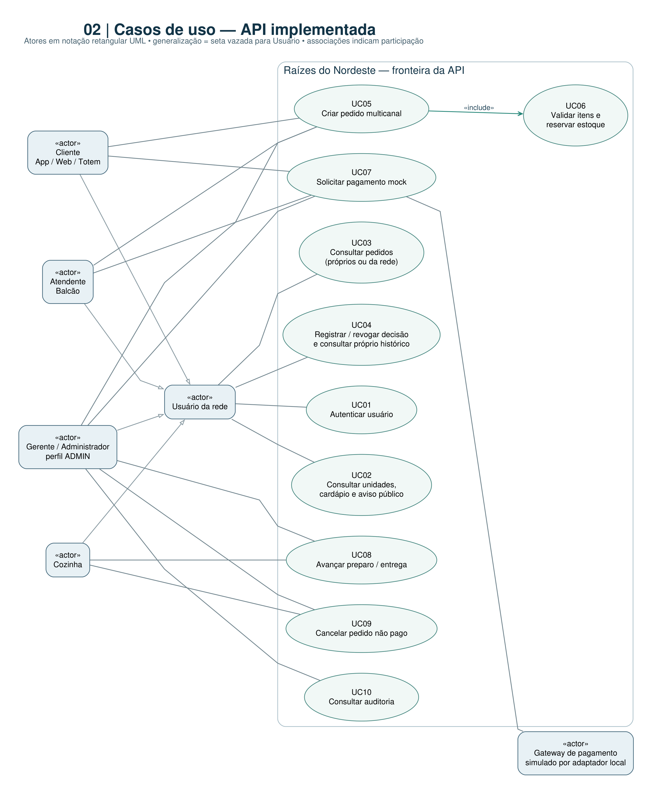
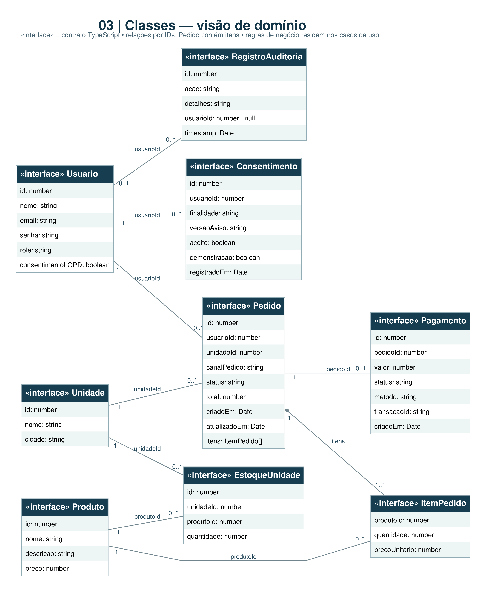
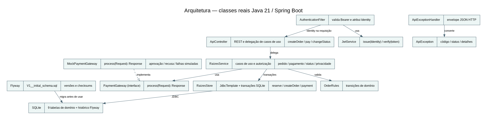
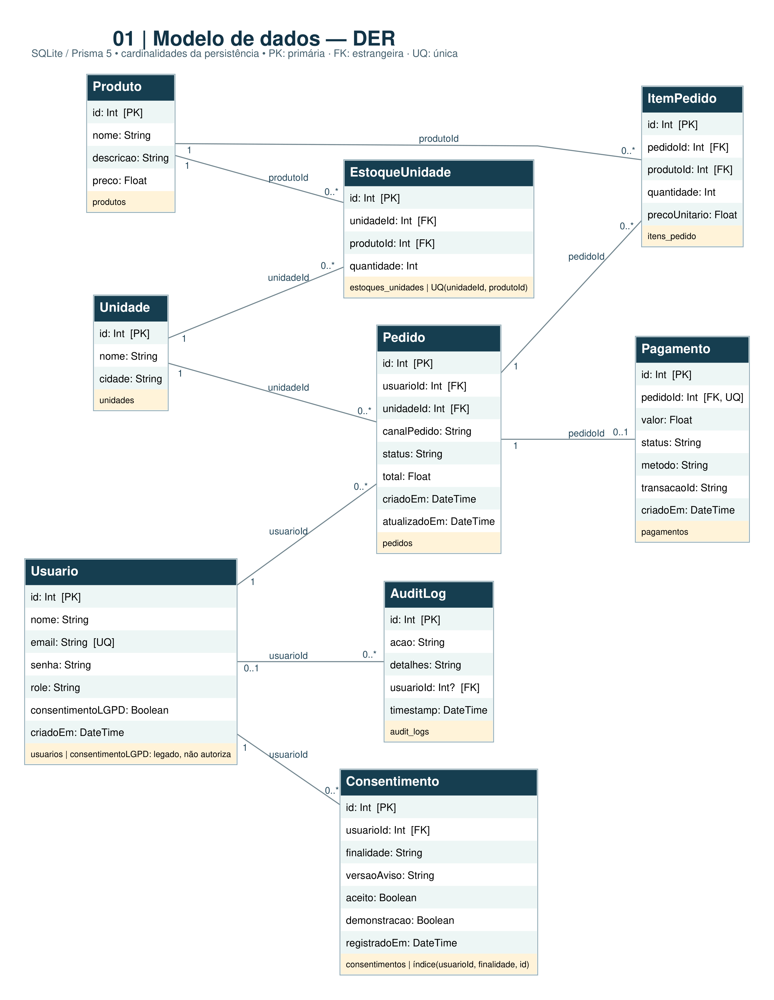
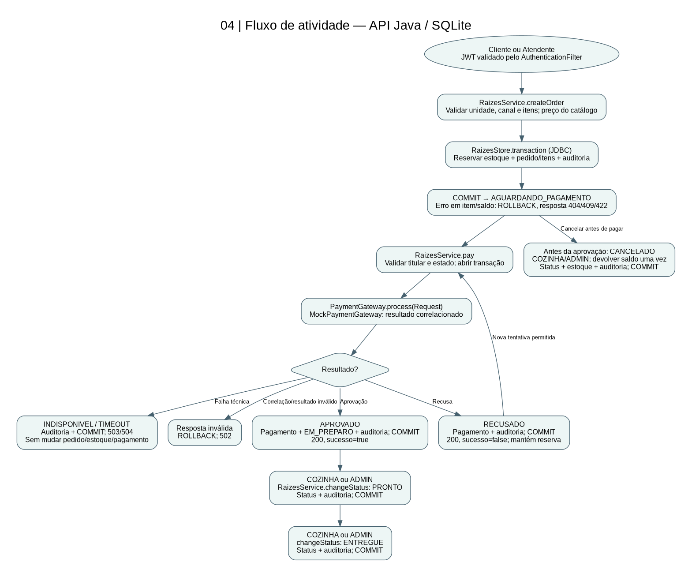

# Raízes do Nordeste

**Angelica Dias Folgado**  
**RU: 4937552**

Projeto acadêmico: API REST para pedidos multicanal, estoque por unidade e pagamento simulado. Relatório técnico da implementação Java 21 e Spring Boot 3.5.

Trabalho: Projeto: Desenvolvimento Back-end (898968)  
Curso: CST Análise e desenvolvimento de sistemas  
Polo: a informar  
Semestre: B fase II 2026 - regular  
Docente: Prof. Me. Luciane Yanase Kanashiro

## Folha de rosto

Angelica Dias Folgado — RU 4937552

Trabalho apresentado à disciplina Projeto: Desenvolvimento Back-end (898968), do curso CST Análise e desenvolvimento de sistemas, no Centro Universitário Internacional UNINTER. Relatório da implementação própria de uma API REST em Java para a rede Raízes do Nordeste. Docente: Prof. Me. Luciane Yanase Kanashiro.

## Sumário

1. Introdução e objetivos ... 3

2. Análise e requisitos ... 4

3. Modelagem e arquitetura ... 6

4. API e contratos ... 7

5. LGPD, privacidade, segurança e auditoria ... 8

6. Plano de testes e evidências ... 9

7. Entrega técnica ... 10

8. Conclusão ... 11

Referências ... 12

Apêndice A - Contratos e exemplos da API ... 13

Apêndice B - Cenários de teste da API ... 29

Apêndice C - Evidências de execução ... 39

Apêndice D - Casos de uso ... 40

Apêndice E - Classes conceituais de domínio ... 41

Apêndice F - Arquitetura Java ... 42

Apêndice G - Diagrama entidade-relacionamento ... 43

Apêndice H - Atividade do fluxo crítico ... 44

## 1. Introdução e objetivos

Uma rede de alimentação precisa receber pedidos por diferentes canais, consultar a disponibilidade de cada unidade e acompanhar o preparo. O projeto implementa uma API para demonstrar esse fluxo com persistência e controle de acesso.

O objetivo é demonstrar o fluxo Pedido -> Pagamento simulado -> Status com banco real, autenticação e regras de autorização. Os canais APP, WEB, TOTEM, BALCAO e PICKUP são atributos do pedido.

A matriz acompanha a rede; cada unidade mantém saldo próprio por produto. ADMIN representa a administração da rede. O sistema não implementa interface gráfica nem integração financeira externa.

Foi escolhido o Fluxo A do material de referência: criar pedido, validar itens e saldo, registrar resultado de pagamento mock e atualizar status. O preço vem do banco, itens repetidos são agregados e o titular do pedido vem do JWT.

Cadastro público, administração completa de produtos/unidades, entradas administrativas de estoque, pontos e campanhas são propostas fora do MVP.

## 2. Análise e requisitos

A API autentica usuários por e-mail e senha e emite JWT. Senhas são armazenadas com BCrypt.

As permissões distinguem CLIENTE, ATENDENTE, COZINHA e ADMIN. Clientes consultam apenas seus pedidos; operações de cozinha e administração seguem regras de perfil.

O catálogo informa produtos e estoque da unidade selecionada. Listagens são paginadas, com limite máximo de 100 registros por página.

Criar pedido, reservar estoque e registrar auditoria ocorre em transação. Itens repetidos são agrupados; falta de saldo ou falha reverte a operação.

O pagamento mock aceita aprovação, recusa e falhas técnicas simuladas. Aprovação move o pedido para EM_PREPARO; a cozinha pode avançar para PRONTO e ENTREGUE.

Pedidos não pagos podem ser cancelados por perfis autorizados, com devolução transacional do estoque. Consentimento de fidelidade é demonstrativo, opcional e revogável.

Requisitos não funcionais atendidos incluem separação por responsabilidades, persistência SQLite, JWT, hashing de senha, padrão JSON de erro, limite de corpo HTTP de 100 KB, paginação e proteção de reserva sob concorrência.

Migrações Flyway versionadas inicializam bancos novos e registram a atualização de bases existentes sem apagar dados. Checksums são validados ao iniciar.

Requisitos propostos: cadastro, CRUD administrativo de catálogo, movimentação de estoque, fidelidade por pontos, promoções e persistência distribuída multiwriter.

## 2.1 Feature crítica: pedido, pagamento e status

Pré-condições: API/banco disponíveis, migrations aplicadas, JWT e perfil permitidos, unidade/produtos existentes, canal válido e saldo suficiente. Para pagar, pedido do titular cliente em AGUARDANDO_PAGAMENTO.

Fluxo: validar e agrupar itens; reservar estoque, persistir pedido/itens e auditoria na transação; solicitar gateway com valor e correlação; validar retorno; persistir pagamento e EM_PREPARO; COZINHA/ADMIN avança para PRONTO e ENTREGUE.

Pós-condições: dados persistentes e estoque consistente. Criação falha reverte a reserva; recusa mantém pedido aguardando; falha técnica não aprova pagamento. Cancelamento autorizado de pedido não pago devolve estoque uma vez.

Exceções: 401 token, 403 perfil/titular, 400/422 entrada, 404 referências, 409 estoque/estado, 502 retorno inválido, 503/504 gateway. Não há Idempotency-Key: repetir criação pode criar outro pedido; pagamento repetido aprovado é bloqueado por estado. Descrição completa: docs/09_FEATURE_CRITICA.md.

## 3. Modelagem e arquitetura

A aplicação foi implementada em Java 21 com Spring Boot 3.5, API REST, JDBC e SQLite. A documentação OpenAPI está disponível em /api-docs.

ApiController traduz HTTP e resolve a identidade; RaizesService coordena os casos de uso; OrderRules valida transições; AuthenticationFilter e JwtService validam identidade; RaizesStore centraliza JDBC e transações; PaymentGateway é a porta de pagamento e MockPaymentGateway seu adaptador local; ApiExceptionHandler projeta erros JSON.

O banco tem nove tabelas: usuarios, unidades, produtos, estoques_unidades, pedidos, itens_pedido, pagamentos, audit_logs e consentimentos. O par unidade/produto do estoque é único; pedidos têm usuário e unidade; itens referenciam pedido e produto; há no máximo um pagamento por pedido.

O código Java usa mapas JDBC e records pontuais; não possui classes Java de entidade para todo o domínio. O diagrama conceitual representa os dados projetados por JDBC; o apêndice de arquitetura Java registra as classes técnicas da implementação atual.

SQLite permite um escritor por vez. Uma trava local serializa transações de escrita dentro do processo; isso não coordena múltiplas instâncias distribuídas.

A implementação da API, dos testes automatizados e das ferramentas mantidas no projeto é Java 21. A afirmação 100% Java refere-se a esse código-fonte executável; documentação, configuração, SQL e artefatos de integração permanecem em seus formatos próprios.

## 4. API e contratos

GET /api/health - público; responde à verificação de saúde.

POST /api/auth/login - público; e-mail e senha; retorna JWT ou 401.

GET /api/unidades?page=1&limit=10 e GET /api/produtos?unidadeId=1&page=1&limit=10 - públicos; listagens paginadas com limite máximo de 100.

POST /api/pedidos - CLIENTE, ATENDENTE ou ADMIN; cria pedido e reserva estoque; 201 em sucesso; 400/401/403/404/409/422 em erros conforme o caso.

GET /api/pedidos?canalPedido=TOTEM&page=1&limit=10 - autenticado; cliente vê apenas pedidos próprios; perfis operacionais consultam a rede.

POST /api/pedidos/{id}/pagamento - titular, ATENDENTE ou ADMIN; resultado aprovado ou recusado; falhas simuladas retornam 503 (INDISPONIVEL) ou 504 (TIMEOUT).

PATCH /api/pedidos/{id}/status - COZINHA ou ADMIN; transições permitidas de preparo/entrega.

GET /api/privacidade/aviso; PUT /api/privacidade/consentimentos/fidelidade; GET /api/privacidade/consentimentos - aviso e histórico do próprio titular.

GET /api/auditoria?acao=CONSULTA_PEDIDOS - ADMIN. GET /api-docs.json serve o contrato OpenAPI; / redireciona para Swagger.

O contrato OpenAPI contém schemas, campos obrigatórios, enumerações, parâmetros, perfis, exemplos e respostas de erro. Ele é aplicado somente a rotas descobertas pelo Spring.

Request de pedido: {"unidadeId": 1, "canalPedido": "APP", "itens": [{"produtoId": 1, "quantidade": 1}]}. O servidor calcula o preço.

Trecho de response 201: {"id": 1, "canalPedido": "APP", "status": "AGUARDANDO_PAGAMENTO", "total": 38.5}. O contrato completo inclui itens, titular, unidade e datas.

Pagamento recusado: envie {"statusSimulado": "RECUSADO"}. Response 200 inclui {"sucesso": false, "statusPedido": "AGUARDANDO_PAGAMENTO"}; a reserva permanece e nova tentativa é permitida.

Erro de estoque, HTTP 409: {"error": "ESTOQUE_INSUFICIENTE", "message": "Estoque insuficiente para Baião de dois.", "details": [], "timestamp": "2026-10-11T13:00:00Z", "path": "/api/pedidos", "requestId": "00000000-0000-4000-8000-000000000001"}. Exemplo ilustrativo; não é uma captura de credenciais.

## 5. LGPD, privacidade, segurança e auditoria

O seed fornece contas fictícias. Senhas são armazenadas com BCrypt; chamadas protegidas usam JWT; perfis e titularidade limitam operações.

O pagamento não captura dados de cartão nem contata adquirente. O consentimento de fidelidade apenas registra uma preferência de demonstração; não há pontos ou envio de marketing.

A aplicação não implementa expurgo periódico, anonimização automatizada ou operação comercial de direitos do titular. O SQLite local e seus backups não são cifrados pela aplicação; segredos e bancos não devem ser publicados.

A discussão de privacidade é acadêmica e não representa certificação jurídica ou parecer.

## 6. Plano de testes e evidências

A validação Maven executada em 11/10/2026 concluiu com BUILD SUCCESS: 20 testes aprovados, sem falhas, erros ou testes ignorados.

Casos positivos cobrem token de autenticação usado nos testes, listagens, pedido criado com itens agrupados, aprovação de pagamento, avanço para PRONTO, consentimento idempotente, seed idempotente e consultas concorrentes.

Casos negativos cobrem credencial/token inválido (401), perfil ou titular indevido (403), dados inválidos (400/422), unidade/produto inexistente (404), estoque insuficiente e conflito de estado (409), gateway (503/504), corpo excessivo (413) e rollback quando falha auditoria.

O reinício local foi validado: pedido e pagamento permaneceram consultáveis em SQLite. Migrações e seed são repetíveis. Restauração de backup não foi ensaiada nesta revisão.

A evidência é JUnit: 16 métodos de integração em ApiIntegrationTest e 2 testes do gateway em MockPaymentGatewayTest, mais 2 testes de migrações Flyway em DatabaseMigrationTest. A coleção Postman executou 32 requisições e 88 asserções, sem falhas.

## 7. Entrega técnica

O README documenta JDK, Maven, variáveis, banco/seed, início da API, Swagger, testes e geração do PDF. O OpenAPI é servido pela aplicação. A cópia limpa de uma revisão anterior foi validada sem target ou banco herdado, usando dependências já disponíveis no Maven local.

Repositório público: https://github.com/angelicafolgado/raizes-do-nordeste. A branch main tem histórico publicado em nome de Angelica Dias Folgado. O material indicado recomenda cinco commits de evolução real; esta revisão registra correções efetivas, sem fabricar histórico.

A coleção Postman foi validada com Newman 6.2.1: 32 requisições e 88 asserções aprovadas; 17 cenários 2xx e 15 cenários de erro, organizados em nove pastas.

Os materiais fornecidos foram adotados como referência por instrução da discente, embora os próprios PDFs indiquem edição para estudo, omissões e prevalência do original. A adoção não autentica a procedência do material no AVA.

## 8. Conclusão

A implementação Java entrega o fluxo acadêmico de pedidos, reserva de estoque, pagamento simulado e acompanhamento operacional. Os testes e a medição documentam somente o comportamento observado no ambiente local.

O código executável da API, testes e ferramentas mantidas está em Java 21. O repositório público contém a entrega Java. A coleção Postman foi validada: 32 requisições e 88 asserções aprovadas. Curso, período e identificação do trabalho foram fornecidos pela discente. O polo permanece marcado como a informar. A referência fornecida foi usada conforme orientação da discente, preservada a ressalva indicada pelos próprios arquivos.

## Referências

UNINTER. Projeto Multidisciplinar: estudo de caso - Raízes do Nordeste. 2026. Versão editada para estudo fornecida pela discente; original institucional prevalece.

UNINTER. Projeto Multidisciplinar: trilha Back-End. 2026. Versão editada para estudo fornecida pela discente; original institucional prevalece.

FOLGADO, Angelica Dias. Raízes do Nordeste: documentação técnica, requisitos e evidências. 2026. Disponível em: https://github.com/angelicafolgado/raizes-do-nordeste. Acesso em: 11 out. 2026.

ORACLE. Java Platform, Standard Edition 21: documentação técnica. [s. d.]. Disponível em: https://docs.oracle.com/en/java/javase/21/. Referência técnica da versão utilizada.

SPRING. Spring Boot: reference documentation. [s. d.]. Disponível em: https://docs.spring.io/spring-boot/reference/. Referência técnica do framework utilizado.

BRASIL. Lei nº 13.709, de 14 de agosto de 2018. Lei Geral de Proteção de Dados Pessoais. Brasília, DF: Presidência da República, 2018. Disponível em: https://www.planalto.gov.br/ccivil_03/_ato2015-2018/2018/lei/l13709compilado.htm. Referência normativa; não representa parecer jurídico.

## Apêndice A - Contratos e exemplos da API

Contratos extraídos do OpenAPI do projeto de Angelica. Os exemplos são ilustrativos; não representam novas capturas de execução. O schema completo está em src/main/resources/openapi-contract.json e em /api-docs.json.

## GET /api/health

Saúde do processo

Não substitui verificação de banco ou disponibilidade de produção. Acesso público; cabeçalho Bearer inválido, quando enviado, retorna 401.

HTTP 200: Operação concluída.; schema: {"$ref":"#/components/schemas/Health"}

Exemplo HTTP 200: {"status":"ok"}

HTTP 401: Autenticação obrigatória ou token inválido.; schema: {"$ref":"#/components/schemas/Erro"}

Exemplo HTTP 401: {"error":"NAO_AUTENTICADO","message":"Autenticação obrigatória ou token inválido.","details":[],"timestamp":"2026-10-11T13:00:00Z","path":"/api/health","requestId":"00000000-0000-4000-8000-000000000001"}

HTTP 500: Falha inesperada no processamento.; schema: {"$ref":"#/components/schemas/Erro"}

Exemplo HTTP 500: {"error":"ERRO_INTERNO_SERVIDOR","message":"Falha inesperada no processamento.","details":[],"timestamp":"2026-10-11T13:00:00Z","path":"/api/health","requestId":"00000000-0000-4000-8000-000000000001"}

## POST /api/auth/login

Autenticar usuário

Credenciais incorretas retornam 401 CREDENCIAIS_INVALIDAS. Senha e hash não aparecem na resposta. Acesso público; cabeçalho Bearer inválido, quando enviado, retorna 401.

Request - schema: {"$ref":"#/components/schemas/LoginRequest"}

Exemplo de request: {"email":"maria@cliente.com","senha":"123456"}

HTTP 200: Operação concluída.; schema: {"$ref":"#/components/schemas/LoginResponse"}

Exemplo HTTP 200: {"accessToken":"jwt-de-exemplo-nao-utilizavel","tokenType":"Bearer","expiresIn":"8h","usuario":{"id":1,"nome":"Maria Cliente","email":"maria@cliente.com","role":"CLIENTE"}}

HTTP 400: Corpo JSON inválido.; schema: {"$ref":"#/components/schemas/Erro"}

Exemplo HTTP 400: {"error":"JSON_INVALIDO","message":"Corpo JSON inválido.","details":[],"timestamp":"2026-10-11T13:00:00Z","path":"/api/auth/login","requestId":"00000000-0000-4000-8000-000000000001"}

HTTP 401: Autenticação obrigatória ou token inválido.; schema: {"$ref":"#/components/schemas/Erro"}

Exemplo HTTP 401: {"error":"NAO_AUTENTICADO","message":"Autenticação obrigatória ou token inválido.","details":[],"timestamp":"2026-10-11T13:00:00Z","path":"/api/auth/login","requestId":"00000000-0000-4000-8000-000000000001"}

HTTP 413: Corpo JSON excede 100 KB.; schema: {"$ref":"#/components/schemas/Erro"}

Exemplo HTTP 413: {"error":"CORPO_MUITO_GRANDE","message":"Corpo JSON excede 100 KB.","details":[],"timestamp":"2026-10-11T13:00:00Z","path":"/api/auth/login","requestId":"00000000-0000-4000-8000-000000000001"}

HTTP 422: Parâmetro inválido.; schema: {"$ref":"#/components/schemas/Erro"}

Exemplo HTTP 422: {"error":"PARAMETRO_INVALIDO","message":"Parâmetro inválido.","details":[],"timestamp":"2026-10-11T13:00:00Z","path":"/api/auth/login","requestId":"00000000-0000-4000-8000-000000000001"}

HTTP 500: Falha inesperada no processamento.; schema: {"$ref":"#/components/schemas/Erro"}

Exemplo HTTP 500: {"error":"ERRO_INTERNO_SERVIDOR","message":"Falha inesperada no processamento.","details":[],"timestamp":"2026-10-11T13:00:00Z","path":"/api/auth/login","requestId":"00000000-0000-4000-8000-000000000001"}

## GET /api/unidades

Listar unidades

 Acesso público; cabeçalho Bearer inválido, quando enviado, retorna 401.

Parâmetros: [{"name":"page","in":"query","required":false,"description":"Número da página.","schema":{"type":"integer","minimum":1,"maximum":2147483647,"default":1}},{"name":"limit","in":"query","required":false,"description":"Registros por página.","schema":{"type":"integer","minimum":1,"maximum":100,"default":10}}]

HTTP 200: Operação concluída.; schema: {"$ref":"#/components/schemas/UnidadesPage"}

Exemplo HTTP 200: {"dados":[{"id":1,"nome":"Raízes Recife","cidade":"Recife"}],"paginacao":{"pagina":1,"limite":10,"total":1,"totalPaginas":1}}

HTTP 401: Autenticação obrigatória ou token inválido.; schema: {"$ref":"#/components/schemas/Erro"}

Exemplo HTTP 401: {"error":"NAO_AUTENTICADO","message":"Autenticação obrigatória ou token inválido.","details":[],"timestamp":"2026-10-11T13:00:00Z","path":"/api/unidades","requestId":"00000000-0000-4000-8000-000000000001"}

HTTP 422: Parâmetro inválido.; schema: {"$ref":"#/components/schemas/Erro"}

Exemplo HTTP 422: {"error":"PARAMETRO_INVALIDO","message":"Parâmetro inválido.","details":[],"timestamp":"2026-10-11T13:00:00Z","path":"/api/unidades","requestId":"00000000-0000-4000-8000-000000000001"}

HTTP 500: Falha inesperada no processamento.; schema: {"$ref":"#/components/schemas/Erro"}

Exemplo HTTP 500: {"error":"ERRO_INTERNO_SERVIDOR","message":"Falha inesperada no processamento.","details":[],"timestamp":"2026-10-11T13:00:00Z","path":"/api/unidades","requestId":"00000000-0000-4000-8000-000000000001"}

## GET /api/produtos

Consultar cardápio e estoque por unidade

 Acesso público; cabeçalho Bearer inválido, quando enviado, retorna 401.

Parâmetros: [{"name":"page","in":"query","required":false,"description":"Número da página.","schema":{"type":"integer","minimum":1,"maximum":2147483647,"default":1}},{"name":"limit","in":"query","required":false,"description":"Registros por página.","schema":{"type":"integer","minimum":1,"maximum":100,"default":10}},{"name":"unidadeId","in":"query","required":false,"description":"Filtra catálogo e saldo da unidade. Unidade inexistente: 404 UNIDADE_NAO_ENCONTRADA.","schema":{"type":"integer","format":"int64","minimum":1}}]

HTTP 200: Operação concluída.; schema: {"$ref":"#/components/schemas/ProdutosPage"}

Exemplo HTTP 200: {"dados":[{"id":1,"nome":"Baião de dois","descricao":"Arroz, feijão-verde e temperos nordestinos","preco":38.5,"estoques":[{"id":1,"unidadeId":1,"produtoId":1,"quantidade":24,"unidade":{"id":1,"nome":"Raízes Recife","cidade":"Recife"}}]}],"paginacao":{"pagina":1,"limite":10,"total":1,"totalPaginas":1}}

HTTP 401: Autenticação obrigatória ou token inválido.; schema: {"$ref":"#/components/schemas/Erro"}

Exemplo HTTP 401: {"error":"NAO_AUTENTICADO","message":"Autenticação obrigatória ou token inválido.","details":[],"timestamp":"2026-10-11T13:00:00Z","path":"/api/produtos","requestId":"00000000-0000-4000-8000-000000000001"}

HTTP 404: Recurso não encontrado.; schema: {"$ref":"#/components/schemas/Erro"}

Exemplo HTTP 404: {"error":"PEDIDO_NAO_ENCONTRADO","message":"Recurso não encontrado.","details":[],"timestamp":"2026-10-11T13:00:00Z","path":"/api/produtos","requestId":"00000000-0000-4000-8000-000000000001"}

HTTP 422: Parâmetro inválido.; schema: {"$ref":"#/components/schemas/Erro"}

Exemplo HTTP 422: {"error":"PARAMETRO_INVALIDO","message":"Parâmetro inválido.","details":[],"timestamp":"2026-10-11T13:00:00Z","path":"/api/produtos","requestId":"00000000-0000-4000-8000-000000000001"}

HTTP 500: Falha inesperada no processamento.; schema: {"$ref":"#/components/schemas/Erro"}

Exemplo HTTP 500: {"error":"ERRO_INTERNO_SERVIDOR","message":"Falha inesperada no processamento.","details":[],"timestamp":"2026-10-11T13:00:00Z","path":"/api/produtos","requestId":"00000000-0000-4000-8000-000000000001"}

## POST /api/pedidos

Criar pedido e reservar estoque

Reserva, itens e auditoria são transacionais. Canal ausente/inválido: 400 CANAL_INVALIDO. Falta de saldo: 409 ESTOQUE_INSUFICIENTE. Preços são lidos do banco. Permissão: CLIENTE, ATENDENTE ou ADMIN; titular obtido do JWT.

Request - schema: {"$ref":"#/components/schemas/PedidoRequest"}

Exemplo de request: {"unidadeId":1,"canalPedido":"TOTEM","itens":[{"produtoId":1,"quantidade":1}]}

HTTP 201: Operação concluída.; schema: {"$ref":"#/components/schemas/Pedido"}

Exemplo HTTP 201: {"id":1,"usuarioId":1,"unidadeId":1,"canalPedido":"TOTEM","status":"AGUARDANDO_PAGAMENTO","total":38.5,"criadoEm":"2026-10-11 10:00:00","atualizadoEm":"2026-10-11 10:00:00","itens":[{"id":1,"pedidoId":1,"produtoId":1,"quantidade":1,"precoUnitario":38.5,"produto":{"id":1,"nome":"Baião de dois","descricao":"Arroz, feijão-verde e temperos nordestinos","preco":38.5}}]}

HTTP 400: Corpo JSON inválido.; schema: {"$ref":"#/components/schemas/Erro"}

Exemplo HTTP 400: {"error":"JSON_INVALIDO","message":"Corpo JSON inválido.","details":[],"timestamp":"2026-10-11T13:00:00Z","path":"/api/pedidos","requestId":"00000000-0000-4000-8000-000000000001"}

HTTP 401: Autenticação obrigatória ou token inválido.; schema: {"$ref":"#/components/schemas/Erro"}

Exemplo HTTP 401: {"error":"NAO_AUTENTICADO","message":"Autenticação obrigatória ou token inválido.","details":[],"timestamp":"2026-10-11T13:00:00Z","path":"/api/pedidos","requestId":"00000000-0000-4000-8000-000000000001"}

HTTP 403: Perfil ou titular sem permissão.; schema: {"$ref":"#/components/schemas/Erro"}

Exemplo HTTP 403: {"error":"ACESSO_NEGADO","message":"Perfil ou titular sem permissão.","details":[],"timestamp":"2026-10-11T13:00:00Z","path":"/api/pedidos","requestId":"00000000-0000-4000-8000-000000000001"}

HTTP 404: Recurso não encontrado.; schema: {"$ref":"#/components/schemas/Erro"}

Exemplo HTTP 404: {"error":"PEDIDO_NAO_ENCONTRADO","message":"Recurso não encontrado.","details":[],"timestamp":"2026-10-11T13:00:00Z","path":"/api/pedidos","requestId":"00000000-0000-4000-8000-000000000001"}

HTTP 409: Estado incompatível com a operação.; schema: {"$ref":"#/components/schemas/Erro"}

Exemplo HTTP 409: {"error":"ESTADO_INVALIDO","message":"Estado incompatível com a operação.","details":[],"timestamp":"2026-10-11T13:00:00Z","path":"/api/pedidos","requestId":"00000000-0000-4000-8000-000000000001"}

HTTP 413: Corpo JSON excede 100 KB.; schema: {"$ref":"#/components/schemas/Erro"}

Exemplo HTTP 413: {"error":"CORPO_MUITO_GRANDE","message":"Corpo JSON excede 100 KB.","details":[],"timestamp":"2026-10-11T13:00:00Z","path":"/api/pedidos","requestId":"00000000-0000-4000-8000-000000000001"}

HTTP 422: Parâmetro inválido.; schema: {"$ref":"#/components/schemas/Erro"}

Exemplo HTTP 422: {"error":"PARAMETRO_INVALIDO","message":"Parâmetro inválido.","details":[],"timestamp":"2026-10-11T13:00:00Z","path":"/api/pedidos","requestId":"00000000-0000-4000-8000-000000000001"}

HTTP 500: Falha inesperada no processamento.; schema: {"$ref":"#/components/schemas/Erro"}

Exemplo HTTP 500: {"error":"ERRO_INTERNO_SERVIDOR","message":"Falha inesperada no processamento.","details":[],"timestamp":"2026-10-11T13:00:00Z","path":"/api/pedidos","requestId":"00000000-0000-4000-8000-000000000001"}

## GET /api/pedidos

Consultar pedidos por canal

 Permissão: qualquer perfil autenticado; CLIENTE consulta somente seus pedidos; perfis operacionais consultam a rede.

Parâmetros: [{"name":"page","in":"query","required":false,"description":"Número da página.","schema":{"type":"integer","minimum":1,"maximum":2147483647,"default":1}},{"name":"limit","in":"query","required":false,"description":"Registros por página.","schema":{"type":"integer","minimum":1,"maximum":100,"default":10}},{"name":"canalPedido","in":"query","required":false,"description":"Canal de origem. Canal inválido retorna 400 CANAL_INVALIDO.","schema":{"type":"string","enum":["APP","TOTEM","BALCAO","PICKUP","WEB"]}}]

HTTP 200: Operação concluída.; schema: {"$ref":"#/components/schemas/PedidosPage"}

Exemplo HTTP 200: {"dados":[{"id":1,"usuarioId":1,"unidadeId":1,"canalPedido":"TOTEM","status":"AGUARDANDO_PAGAMENTO","total":38.5,"criadoEm":"2026-10-11 10:00:00","atualizadoEm":"2026-10-11 10:00:00","itens":[{"id":1,"pedidoId":1,"produtoId":1,"quantidade":1,"precoUnitario":38.5,"produto":{"id":1,"nome":"Baião de dois","descricao":"Arroz, feijão-verde e temperos nordestinos","preco":38.5}}]}],"paginacao":{"pagina":1,"limite":10,"total":1,"totalPaginas":1}}

HTTP 400: Corpo JSON inválido.; schema: {"$ref":"#/components/schemas/Erro"}

Exemplo HTTP 400: {"error":"JSON_INVALIDO","message":"Corpo JSON inválido.","details":[],"timestamp":"2026-10-11T13:00:00Z","path":"/api/pedidos","requestId":"00000000-0000-4000-8000-000000000001"}

HTTP 401: Autenticação obrigatória ou token inválido.; schema: {"$ref":"#/components/schemas/Erro"}

Exemplo HTTP 401: {"error":"NAO_AUTENTICADO","message":"Autenticação obrigatória ou token inválido.","details":[],"timestamp":"2026-10-11T13:00:00Z","path":"/api/pedidos","requestId":"00000000-0000-4000-8000-000000000001"}

HTTP 422: Parâmetro inválido.; schema: {"$ref":"#/components/schemas/Erro"}

Exemplo HTTP 422: {"error":"PARAMETRO_INVALIDO","message":"Parâmetro inválido.","details":[],"timestamp":"2026-10-11T13:00:00Z","path":"/api/pedidos","requestId":"00000000-0000-4000-8000-000000000001"}

HTTP 500: Falha inesperada no processamento.; schema: {"$ref":"#/components/schemas/Erro"}

Exemplo HTTP 500: {"error":"ERRO_INTERNO_SERVIDOR","message":"Falha inesperada no processamento.","details":[],"timestamp":"2026-10-11T13:00:00Z","path":"/api/pedidos","requestId":"00000000-0000-4000-8000-000000000001"}

## POST /api/pedidos/{id}/pagamento

Solicitar pagamento simulado

Recusa retorna 200, sucesso=false e AGUARDANDO_PAGAMENTO; permite nova tentativa. Aprovação muda para EM_PREPARO. Pedido já aprovado retorna 409. Falhas técnicas são simuladas imediatamente; não há cobrança externa. Permissão: CLIENTE titular do pedido, ATENDENTE ou ADMIN.

Parâmetros: [{"name":"id","in":"path","required":true,"description":"Identificador do pedido.","schema":{"type":"integer","format":"int64","minimum":1}}]

Request - schema: {"$ref":"#/components/schemas/PagamentoRequest"}

Exemplo de request: {"statusSimulado":"APROVADO"}

HTTP 200: Operação concluída.; schema: {"$ref":"#/components/schemas/PagamentoResponse"}

Exemplo HTTP 200: {"sucesso":true,"mensagem":"Pagamento simulado aprovado.","transacaoId":"mock-exemplo","statusPedido":"EM_PREPARO","detalhes":{"id":1,"pedidoId":1,"valor":38.5,"status":"APROVADO","metodo":"SIMULACAO_GATEWAY","transacaoId":"mock-exemplo","criadoEm":"2026-10-11 10:00:00"}}

HTTP 400: Corpo JSON inválido.; schema: {"$ref":"#/components/schemas/Erro"}

Exemplo HTTP 400: {"error":"JSON_INVALIDO","message":"Corpo JSON inválido.","details":[],"timestamp":"2026-10-11T13:00:00Z","path":"/api/pedidos/1/pagamento","requestId":"00000000-0000-4000-8000-000000000001"}

HTTP 401: Autenticação obrigatória ou token inválido.; schema: {"$ref":"#/components/schemas/Erro"}

Exemplo HTTP 401: {"error":"NAO_AUTENTICADO","message":"Autenticação obrigatória ou token inválido.","details":[],"timestamp":"2026-10-11T13:00:00Z","path":"/api/pedidos/1/pagamento","requestId":"00000000-0000-4000-8000-000000000001"}

HTTP 403: Perfil ou titular sem permissão.; schema: {"$ref":"#/components/schemas/Erro"}

Exemplo HTTP 403: {"error":"ACESSO_NEGADO","message":"Perfil ou titular sem permissão.","details":[],"timestamp":"2026-10-11T13:00:00Z","path":"/api/pedidos/1/pagamento","requestId":"00000000-0000-4000-8000-000000000001"}

HTTP 404: Recurso não encontrado.; schema: {"$ref":"#/components/schemas/Erro"}

Exemplo HTTP 404: {"error":"PEDIDO_NAO_ENCONTRADO","message":"Recurso não encontrado.","details":[],"timestamp":"2026-10-11T13:00:00Z","path":"/api/pedidos/1/pagamento","requestId":"00000000-0000-4000-8000-000000000001"}

HTTP 409: Estado incompatível com a operação.; schema: {"$ref":"#/components/schemas/Erro"}

Exemplo HTTP 409: {"error":"ESTADO_INVALIDO","message":"Estado incompatível com a operação.","details":[],"timestamp":"2026-10-11T13:00:00Z","path":"/api/pedidos/1/pagamento","requestId":"00000000-0000-4000-8000-000000000001"}

HTTP 413: Corpo JSON excede 100 KB.; schema: {"$ref":"#/components/schemas/Erro"}

Exemplo HTTP 413: {"error":"CORPO_MUITO_GRANDE","message":"Corpo JSON excede 100 KB.","details":[],"timestamp":"2026-10-11T13:00:00Z","path":"/api/pedidos/1/pagamento","requestId":"00000000-0000-4000-8000-000000000001"}

HTTP 422: Parâmetro inválido.; schema: {"$ref":"#/components/schemas/Erro"}

Exemplo HTTP 422: {"error":"PARAMETRO_INVALIDO","message":"Parâmetro inválido.","details":[],"timestamp":"2026-10-11T13:00:00Z","path":"/api/pedidos/1/pagamento","requestId":"00000000-0000-4000-8000-000000000001"}

HTTP 500: Falha inesperada no processamento.; schema: {"$ref":"#/components/schemas/Erro"}

Exemplo HTTP 500: {"error":"ERRO_INTERNO_SERVIDOR","message":"Falha inesperada no processamento.","details":[],"timestamp":"2026-10-11T13:00:00Z","path":"/api/pedidos/1/pagamento","requestId":"00000000-0000-4000-8000-000000000001"}

HTTP 502: Resposta do gateway não corresponde à solicitação.; schema: {"$ref":"#/components/schemas/Erro"}

Exemplo HTTP 502: {"error":"RESPOSTA_GATEWAY_INVALIDA","message":"Resposta do gateway não corresponde à solicitação.","details":[],"timestamp":"2026-10-11T13:00:00Z","path":"/api/pedidos/1/pagamento","requestId":"00000000-0000-4000-8000-000000000001"}

HTTP 503: Gateway simulado indisponível.; schema: {"$ref":"#/components/schemas/Erro"}

Exemplo HTTP 503: {"error":"GATEWAY_INDISPONIVEL","message":"Gateway simulado indisponível.","details":[],"timestamp":"2026-10-11T13:00:00Z","path":"/api/pedidos/1/pagamento","requestId":"00000000-0000-4000-8000-000000000001"}

HTTP 504: Tempo de resposta do gateway simulado esgotado.; schema: {"$ref":"#/components/schemas/Erro"}

Exemplo HTTP 504: {"error":"GATEWAY_TIMEOUT","message":"Tempo de resposta do gateway simulado esgotado.","details":[],"timestamp":"2026-10-11T13:00:00Z","path":"/api/pedidos/1/pagamento","requestId":"00000000-0000-4000-8000-000000000001"}

## PATCH /api/pedidos/{id}/status

Atualizar status ou cancelar pedido não pago

Cancelamento devolve estoque uma única vez. Saltos/regressões de status retornam 409 TRANSICAO_INVALIDA. Permissão: COZINHA ou ADMIN.

Parâmetros: [{"name":"id","in":"path","required":true,"description":"Identificador do pedido.","schema":{"type":"integer","format":"int64","minimum":1}}]

Request - schema: {"$ref":"#/components/schemas/StatusRequest"}

Exemplo de request: {"status":"PRONTO"}

HTTP 200: Operação concluída.; schema: {"$ref":"#/components/schemas/Pedido"}

Exemplo HTTP 200: {"id":1,"usuarioId":1,"unidadeId":1,"canalPedido":"TOTEM","status":"PRONTO","total":38.5,"criadoEm":"2026-10-11 10:00:00","atualizadoEm":"2026-10-11 10:00:00","itens":[{"id":1,"pedidoId":1,"produtoId":1,"quantidade":1,"precoUnitario":38.5,"produto":{"id":1,"nome":"Baião de dois","descricao":"Arroz, feijão-verde e temperos nordestinos","preco":38.5}}]}

HTTP 400: Corpo JSON inválido.; schema: {"$ref":"#/components/schemas/Erro"}

Exemplo HTTP 400: {"error":"JSON_INVALIDO","message":"Corpo JSON inválido.","details":[],"timestamp":"2026-10-11T13:00:00Z","path":"/api/pedidos/1/status","requestId":"00000000-0000-4000-8000-000000000001"}

HTTP 401: Autenticação obrigatória ou token inválido.; schema: {"$ref":"#/components/schemas/Erro"}

Exemplo HTTP 401: {"error":"NAO_AUTENTICADO","message":"Autenticação obrigatória ou token inválido.","details":[],"timestamp":"2026-10-11T13:00:00Z","path":"/api/pedidos/1/status","requestId":"00000000-0000-4000-8000-000000000001"}

HTTP 403: Perfil ou titular sem permissão.; schema: {"$ref":"#/components/schemas/Erro"}

Exemplo HTTP 403: {"error":"ACESSO_NEGADO","message":"Perfil ou titular sem permissão.","details":[],"timestamp":"2026-10-11T13:00:00Z","path":"/api/pedidos/1/status","requestId":"00000000-0000-4000-8000-000000000001"}

HTTP 404: Recurso não encontrado.; schema: {"$ref":"#/components/schemas/Erro"}

Exemplo HTTP 404: {"error":"PEDIDO_NAO_ENCONTRADO","message":"Recurso não encontrado.","details":[],"timestamp":"2026-10-11T13:00:00Z","path":"/api/pedidos/1/status","requestId":"00000000-0000-4000-8000-000000000001"}

HTTP 409: Estado incompatível com a operação.; schema: {"$ref":"#/components/schemas/Erro"}

Exemplo HTTP 409: {"error":"ESTADO_INVALIDO","message":"Estado incompatível com a operação.","details":[],"timestamp":"2026-10-11T13:00:00Z","path":"/api/pedidos/1/status","requestId":"00000000-0000-4000-8000-000000000001"}

HTTP 413: Corpo JSON excede 100 KB.; schema: {"$ref":"#/components/schemas/Erro"}

Exemplo HTTP 413: {"error":"CORPO_MUITO_GRANDE","message":"Corpo JSON excede 100 KB.","details":[],"timestamp":"2026-10-11T13:00:00Z","path":"/api/pedidos/1/status","requestId":"00000000-0000-4000-8000-000000000001"}

HTTP 422: Parâmetro inválido.; schema: {"$ref":"#/components/schemas/Erro"}

Exemplo HTTP 422: {"error":"PARAMETRO_INVALIDO","message":"Parâmetro inválido.","details":[],"timestamp":"2026-10-11T13:00:00Z","path":"/api/pedidos/1/status","requestId":"00000000-0000-4000-8000-000000000001"}

HTTP 500: Falha inesperada no processamento.; schema: {"$ref":"#/components/schemas/Erro"}

Exemplo HTTP 500: {"error":"ERRO_INTERNO_SERVIDOR","message":"Falha inesperada no processamento.","details":[],"timestamp":"2026-10-11T13:00:00Z","path":"/api/pedidos/1/status","requestId":"00000000-0000-4000-8000-000000000001"}

## GET /api/privacidade/aviso

Consultar aviso de demonstração opcional

 Acesso público; cabeçalho Bearer inválido, quando enviado, retorna 401.

HTTP 200: Operação concluída.; schema: {"$ref":"#/components/schemas/Aviso"}

Exemplo HTTP 200: {"finalidade":"FIDELIDADE","versaoAviso":"1.0","demonstracao":true,"opcional":true,"titulo":"Preferência de fidelidade — demonstração acadêmica","descricao":"Registra preferência opcional; não acumula pontos ou envia marketing.","dados":["Identificador do titular","Decisão","Versão","Data"],"revogacao":"Envie aceito=false na rota de consentimento.","retencao":"Revisão manual ao encerrar a avaliação; sem expurgo automático.","compartilhamento":"Nenhum provedor externo nesta demonstração."}

HTTP 401: Autenticação obrigatória ou token inválido.; schema: {"$ref":"#/components/schemas/Erro"}

Exemplo HTTP 401: {"error":"NAO_AUTENTICADO","message":"Autenticação obrigatória ou token inválido.","details":[],"timestamp":"2026-10-11T13:00:00Z","path":"/api/privacidade/aviso","requestId":"00000000-0000-4000-8000-000000000001"}

HTTP 500: Falha inesperada no processamento.; schema: {"$ref":"#/components/schemas/Erro"}

Exemplo HTTP 500: {"error":"ERRO_INTERNO_SERVIDOR","message":"Falha inesperada no processamento.","details":[],"timestamp":"2026-10-11T13:00:00Z","path":"/api/privacidade/aviso","requestId":"00000000-0000-4000-8000-000000000001"}

## PUT /api/privacidade/consentimentos/fidelidade

Registrar aceite ou revogação

Aceite exige versaoAviso=1.0; revogação aceita apenas aceito=false. Operação idempotente; não ativa pontos e não bloqueia pedidos. Versão incorreta retorna 422 VERSAO_AVISO_INVALIDA. Permissão: qualquer perfil autenticado, apenas o próprio titular.

Request - schema: {"$ref":"#/components/schemas/ConsentimentoRequest"}

Exemplo de request: {"aceito":true,"versaoAviso":"1.0"}

HTTP 200: Operação concluída.; schema: {"$ref":"#/components/schemas/Consentimento"}

Exemplo HTTP 200: {"id":1,"usuarioId":1,"finalidade":"FIDELIDADE","versaoAviso":"1.0","aceito":true,"demonstracao":true,"registradoEm":"2026-10-11 10:00:00"}

HTTP 400: Corpo JSON inválido.; schema: {"$ref":"#/components/schemas/Erro"}

Exemplo HTTP 400: {"error":"JSON_INVALIDO","message":"Corpo JSON inválido.","details":[],"timestamp":"2026-10-11T13:00:00Z","path":"/api/privacidade/consentimentos/fidelidade","requestId":"00000000-0000-4000-8000-000000000001"}

HTTP 401: Autenticação obrigatória ou token inválido.; schema: {"$ref":"#/components/schemas/Erro"}

Exemplo HTTP 401: {"error":"NAO_AUTENTICADO","message":"Autenticação obrigatória ou token inválido.","details":[],"timestamp":"2026-10-11T13:00:00Z","path":"/api/privacidade/consentimentos/fidelidade","requestId":"00000000-0000-4000-8000-000000000001"}

HTTP 413: Corpo JSON excede 100 KB.; schema: {"$ref":"#/components/schemas/Erro"}

Exemplo HTTP 413: {"error":"CORPO_MUITO_GRANDE","message":"Corpo JSON excede 100 KB.","details":[],"timestamp":"2026-10-11T13:00:00Z","path":"/api/privacidade/consentimentos/fidelidade","requestId":"00000000-0000-4000-8000-000000000001"}

HTTP 422: Parâmetro inválido.; schema: {"$ref":"#/components/schemas/Erro"}

Exemplo HTTP 422: {"error":"PARAMETRO_INVALIDO","message":"Parâmetro inválido.","details":[],"timestamp":"2026-10-11T13:00:00Z","path":"/api/privacidade/consentimentos/fidelidade","requestId":"00000000-0000-4000-8000-000000000001"}

HTTP 500: Falha inesperada no processamento.; schema: {"$ref":"#/components/schemas/Erro"}

Exemplo HTTP 500: {"error":"ERRO_INTERNO_SERVIDOR","message":"Falha inesperada no processamento.","details":[],"timestamp":"2026-10-11T13:00:00Z","path":"/api/privacidade/consentimentos/fidelidade","requestId":"00000000-0000-4000-8000-000000000001"}

## GET /api/privacidade/consentimentos

Consultar estado e histórico próprios

 Permissão: qualquer perfil autenticado, apenas o próprio titular.

Parâmetros: [{"name":"page","in":"query","required":false,"description":"Número da página.","schema":{"type":"integer","minimum":1,"maximum":2147483647,"default":1}},{"name":"limit","in":"query","required":false,"description":"Registros por página.","schema":{"type":"integer","minimum":1,"maximum":100,"default":10}}]

HTTP 200: Operação concluída.; schema: {"$ref":"#/components/schemas/ConsentimentosPage"}

Exemplo HTTP 200: {"dados":[{"id":1,"usuarioId":1,"finalidade":"FIDELIDADE","versaoAviso":"1.0","aceito":true,"demonstracao":true,"registradoEm":"2026-10-11 10:00:00"}],"paginacao":{"pagina":1,"limite":10,"total":1,"totalPaginas":1},"atual":{"finalidade":"FIDELIDADE","versaoAviso":"1.0","aceito":true,"demonstracao":true,"ultimoRegistroId":1}}

HTTP 401: Autenticação obrigatória ou token inválido.; schema: {"$ref":"#/components/schemas/Erro"}

Exemplo HTTP 401: {"error":"NAO_AUTENTICADO","message":"Autenticação obrigatória ou token inválido.","details":[],"timestamp":"2026-10-11T13:00:00Z","path":"/api/privacidade/consentimentos","requestId":"00000000-0000-4000-8000-000000000001"}

HTTP 422: Parâmetro inválido.; schema: {"$ref":"#/components/schemas/Erro"}

Exemplo HTTP 422: {"error":"PARAMETRO_INVALIDO","message":"Parâmetro inválido.","details":[],"timestamp":"2026-10-11T13:00:00Z","path":"/api/privacidade/consentimentos","requestId":"00000000-0000-4000-8000-000000000001"}

HTTP 500: Falha inesperada no processamento.; schema: {"$ref":"#/components/schemas/Erro"}

Exemplo HTTP 500: {"error":"ERRO_INTERNO_SERVIDOR","message":"Falha inesperada no processamento.","details":[],"timestamp":"2026-10-11T13:00:00Z","path":"/api/privacidade/consentimentos","requestId":"00000000-0000-4000-8000-000000000001"}

## GET /api/auditoria

Consultar metadados de auditoria

Projeção segura de detalhes; cada consulta gera CONSULTA_AUDITORIA depois de selecionar a página. Permissão: ADMIN.

Parâmetros: [{"name":"page","in":"query","required":false,"description":"Número da página.","schema":{"type":"integer","minimum":1,"maximum":2147483647,"default":1}},{"name":"limit","in":"query","required":false,"description":"Registros por página.","schema":{"type":"integer","minimum":1,"maximum":100,"default":10}},{"name":"acao","in":"query","required":false,"description":"Ação exata, por exemplo CONSENTIMENTO_REVOGADO.","schema":{"type":"string","pattern":"^[A-Z_]{1,64}$"}}]

HTTP 200: Operação concluída.; schema: {"$ref":"#/components/schemas/AuditoriasPage"}

Exemplo HTTP 200: {"dados":[{"id":1,"acao":"CRIACAO_PEDIDO","timestamp":"2026-10-11 10:00:00","detalhes":{"pedidoId":1,"canal":"TOTEM","total":38.5}}],"paginacao":{"pagina":1,"limite":10,"total":1,"totalPaginas":1}}

HTTP 401: Autenticação obrigatória ou token inválido.; schema: {"$ref":"#/components/schemas/Erro"}

Exemplo HTTP 401: {"error":"NAO_AUTENTICADO","message":"Autenticação obrigatória ou token inválido.","details":[],"timestamp":"2026-10-11T13:00:00Z","path":"/api/auditoria","requestId":"00000000-0000-4000-8000-000000000001"}

HTTP 403: Perfil ou titular sem permissão.; schema: {"$ref":"#/components/schemas/Erro"}

Exemplo HTTP 403: {"error":"ACESSO_NEGADO","message":"Perfil ou titular sem permissão.","details":[],"timestamp":"2026-10-11T13:00:00Z","path":"/api/auditoria","requestId":"00000000-0000-4000-8000-000000000001"}

HTTP 422: Parâmetro inválido.; schema: {"$ref":"#/components/schemas/Erro"}

Exemplo HTTP 422: {"error":"PARAMETRO_INVALIDO","message":"Parâmetro inválido.","details":[],"timestamp":"2026-10-11T13:00:00Z","path":"/api/auditoria","requestId":"00000000-0000-4000-8000-000000000001"}

HTTP 500: Falha inesperada no processamento.; schema: {"$ref":"#/components/schemas/Erro"}

Exemplo HTTP 500: {"error":"ERRO_INTERNO_SERVIDOR","message":"Falha inesperada no processamento.","details":[],"timestamp":"2026-10-11T13:00:00Z","path":"/api/auditoria","requestId":"00000000-0000-4000-8000-000000000001"}

## GET /

Redirecionar para Swagger

HTTP 302: Redirecionamento.

## Apêndice B - Cenários de teste da API

Cenários do plano de testes próprio. Pré-condição geral: API iniciada, migrations e seed aplicados em banco de demonstração separado. Tokens são obtidos pelos logins da coleção. As entradas completas constam em docs/04_PLANO_DE_TESTES.md e postman/raizes_nordeste_clean_collection.json.

## T01 - Login cliente

Operação: POST /api/auth/login

Pré-condições: API iniciada; migrations e seed aplicados

Entrada: {"email":"maria@cliente.com","senha":"123456"}

Resultado esperado: 200; accessToken presente; CLIENTE

Localização na coleção: 01 Auth/T01 - Login cliente

## T02 - Login cozinha

Operação: POST /api/auth/login

Pré-condições: API iniciada; migrations e seed aplicados

Entrada: {"email":"cozinha@raizes.com","senha":"123456"}

Resultado esperado: 200; accessToken presente; COZINHA

Localização na coleção: 01 Auth/T02 - Login cozinha

## T03 - Senha incorreta

Operação: POST /api/auth/login

Pré-condições: API iniciada; migrations e seed aplicados

Entrada: {"email":"maria@cliente.com","senha":"errada"}

Resultado esperado: 401; CREDENCIAIS_INVALIDAS

Localização na coleção: 01 Auth/T03 - Senha incorreta

## T04 - Cardápio

Operação: GET /api/produtos

Pré-condições: API iniciada; migrations e seed aplicados

Entrada: Sem body; parâmetros na rota

Resultado esperado: 200; dados e paginacao; estoque por unidade

Localização na coleção: 02 Cardápio/T04 - Cardápio

## T05 - Criar pedido TOTEM

Operação: POST /api/pedidos

Pré-condições: API iniciada; migrations e seed aplicados; {{token_cliente}} obtido no login anterior

Entrada: {"unidadeId":1,"canalPedido":"TOTEM","itens":[{"produtoId":1,"quantidade":1}]}

Resultado esperado: 201; id capturado; AGUARDANDO_PAGAMENTO; total 38,50

Localização na coleção: 03 Pedidos/T05 - Criar pedido TOTEM

## T06 - Filtrar pedidos

Operação: GET /api/pedidos?canalPedido=TOTEM&page=1&limit=5

Pré-condições: API iniciada; migrations e seed aplicados; {{token_cliente}} obtido no login anterior

Entrada: Sem body; parâmetros na rota

Resultado esperado: 200; canal TOTEM nos resultados

Localização na coleção: 03 Pedidos/T06 - Filtrar pedidos

## T07 - Canal inválido

Operação: POST /api/pedidos

Pré-condições: API iniciada; migrations e seed aplicados; {{token_cliente}} obtido no login anterior

Entrada: {"unidadeId":1,"canalPedido":"INVALIDO","itens":[{"produtoId":1,"quantidade":1}]}

Resultado esperado: 400; CANAL_INVALIDO

Localização na coleção: 03 Pedidos/T07 - Canal inválido

## T08 - Estoque insuficiente

Operação: POST /api/pedidos

Pré-condições: API iniciada; migrations e seed aplicados; {{token_cliente}} obtido no login anterior

Entrada: {"unidadeId":1,"canalPedido":"TOTEM","itens":[{"produtoId":1,"quantidade":99999}]}

Resultado esperado: 409; ESTOQUE_INSUFICIENTE

Localização na coleção: 03 Pedidos/T08 - Estoque insuficiente

## T09 - Quantidade inválida

Operação: POST /api/pedidos

Pré-condições: API iniciada; migrations e seed aplicados; {{token_cliente}} obtido no login anterior

Entrada: {"unidadeId":1,"canalPedido":"TOTEM","itens":[{"produtoId":1,"quantidade":0}]}

Resultado esperado: 422; PARAMETRO_INVALIDO

Localização na coleção: 03 Pedidos/T09 - Quantidade inválida

## T10 - Pagamento recusado

Operação: POST /api/pedidos/{{pedidoId}}/pagamento

Pré-condições: API iniciada; migrations e seed aplicados; {{token_cliente}} obtido no login anterior; pedidoId capturado em T05; pedido aguardando pagamento

Entrada: {"statusSimulado":"RECUSADO"}

Resultado esperado: 200; sucesso=false; AGUARDANDO_PAGAMENTO

Localização na coleção: 04 Pagamento mock/T10 - Pagamento recusado

## T11 - Gateway indisponível

Operação: POST /api/pedidos/{{pedidoId}}/pagamento

Pré-condições: API iniciada; migrations e seed aplicados; {{token_cliente}} obtido no login anterior; pedidoId capturado em T05; pedido aguardando pagamento

Entrada: {"statusSimulado":"INDISPONIVEL"}

Resultado esperado: 503; GATEWAY_INDISPONIVEL

Localização na coleção: 04 Pagamento mock/T11 - Gateway indisponível

## T12 - Timeout gateway

Operação: POST /api/pedidos/{{pedidoId}}/pagamento

Pré-condições: API iniciada; migrations e seed aplicados; {{token_cliente}} obtido no login anterior; pedidoId capturado em T05; pedido aguardando pagamento

Entrada: {"statusSimulado":"TIMEOUT"}

Resultado esperado: 504; GATEWAY_TIMEOUT

Localização na coleção: 04 Pagamento mock/T12 - Timeout gateway

## T13 - Nova tentativa aprovada

Operação: POST /api/pedidos/{{pedidoId}}/pagamento

Pré-condições: API iniciada; migrations e seed aplicados; {{token_cliente}} obtido no login anterior; pedidoId capturado em T05; pedido aguardando pagamento

Entrada: {"statusSimulado":"APROVADO"}

Resultado esperado: 200; sucesso=true; EM_PREPARO

Localização na coleção: 04 Pagamento mock/T13 - Nova tentativa aprovada

## T14 - Cliente sem permissão

Operação: PATCH /api/pedidos/{{pedidoId}}/status

Pré-condições: API iniciada; migrations e seed aplicados; {{token_cliente}} obtido no login anterior; pedidoId capturado em T05; pagamento aprovado em T13

Entrada: {"status":"PRONTO"}

Resultado esperado: 403; ACESSO_NEGADO

Localização na coleção: 05 Status e duplicidade/T14 - Cliente sem permissão

## T15 - Cozinha marca pronto

Operação: PATCH /api/pedidos/{{pedidoId}}/status

Pré-condições: API iniciada; migrations e seed aplicados; {{token_cozinha}} obtido no login anterior; pedidoId capturado em T05; pagamento aprovado em T13

Entrada: {"status":"PRONTO"}

Resultado esperado: 200; status=PRONTO

Localização na coleção: 05 Status e duplicidade/T15 - Cozinha marca pronto

## T16 - Entrega

Operação: PATCH /api/pedidos/{{pedidoId}}/status

Pré-condições: API iniciada; migrations e seed aplicados; {{token_cozinha}} obtido no login anterior; pedidoId capturado em T05; pedido PRONTO após T15

Entrada: {"status":"ENTREGUE"}

Resultado esperado: 200; status=ENTREGUE

Localização na coleção: 05 Status e duplicidade/T16 - Entrega

## T17 - Pagamento repetido

Operação: POST /api/pedidos/{{pedidoId}}/pagamento

Pré-condições: API iniciada; migrations e seed aplicados; {{token_cliente}} obtido no login anterior; pedidoId capturado em T05; pedido já ENTREGUE

Entrada: {"statusSimulado":"APROVADO"}

Resultado esperado: 409; ESTADO_INVALIDO

Localização na coleção: 05 Status e duplicidade/T17 - Pagamento repetido

## T18 - Sem autenticação

Operação: GET /api/pedidos

Pré-condições: API iniciada; migrations e seed aplicados

Entrada: Sem body; parâmetros na rota

Resultado esperado: 401; NAO_AUTENTICADO

Localização na coleção: 06 Acesso e paginação/T18 - Sem autenticação

## T19 - Produtos paginados

Operação: GET /api/produtos?unidadeId=1&page=2&limit=1

Pré-condições: API iniciada; migrations e seed aplicados

Entrada: Sem body; parâmetros na rota

Resultado esperado: 200; pagina=2; um produto

Localização na coleção: 06 Acesso e paginação/T19 - Produtos paginados

## T20 - Unidades paginadas

Operação: GET /api/unidades?page=1&limit=1

Pré-condições: API iniciada; migrations e seed aplicados

Entrada: Sem body; parâmetros na rota

Resultado esperado: 200; uma unidade

Localização na coleção: 06 Acesso e paginação/T20 - Unidades paginadas

## T21 - Aviso opcional

Operação: GET /api/privacidade/aviso

Pré-condições: API iniciada; migrations e seed aplicados

Entrada: Sem body; parâmetros na rota

Resultado esperado: 200; opcional=true; versão 1.0

Localização na coleção: 07 Privacidade/T21 - Aviso opcional

## T22 - Aceitar demonstração

Operação: PUT /api/privacidade/consentimentos/fidelidade

Pré-condições: API iniciada; migrations e seed aplicados; {{token_cliente}} obtido no login anterior

Entrada: {"aceito":true,"versaoAviso":"1.0"}

Resultado esperado: 200; aceito=true

Localização na coleção: 07 Privacidade/T22 - Aceitar demonstração

## T23 - Histórico próprio

Operação: GET /api/privacidade/consentimentos

Pré-condições: API iniciada; migrations e seed aplicados; {{token_cliente}} obtido no login anterior; aceite registrado em T22

Entrada: Sem body; parâmetros na rota

Resultado esperado: 200; atual.aceito=true

Localização na coleção: 07 Privacidade/T23 - Histórico próprio

## T24 - Revogar decisão

Operação: PUT /api/privacidade/consentimentos/fidelidade

Pré-condições: API iniciada; migrations e seed aplicados; {{token_cliente}} obtido no login anterior

Entrada: {"aceito":false}

Resultado esperado: 200; aceito=false

Localização na coleção: 07 Privacidade/T24 - Revogar decisão

## T25 - Histórico sem token

Operação: GET /api/privacidade/consentimentos

Pré-condições: API iniciada; migrations e seed aplicados

Entrada: Sem body; parâmetros na rota

Resultado esperado: 401; NAO_AUTENTICADO

Localização na coleção: 07 Privacidade/T25 - Histórico sem token

## T26 - Cliente não acessa auditoria

Operação: GET /api/auditoria

Pré-condições: API iniciada; migrations e seed aplicados; {{token_cliente}} obtido no login anterior

Entrada: Sem body; parâmetros na rota

Resultado esperado: 403; ACESSO_NEGADO

Localização na coleção: 08 Auditoria/T26 - Cliente não acessa auditoria

## T27 - Login administrador

Operação: POST /api/auth/login

Pré-condições: API iniciada; migrations e seed aplicados

Entrada: {"email":"admin@raizes.com","senha":"123456"}

Resultado esperado: 200; accessToken presente; ADMIN

Localização na coleção: 08 Auditoria/T27 - Login administrador

## T28 - Evidência de revogação auditada

Operação: GET /api/auditoria?acao=CONSENTIMENTO_REVOGADO&limit=1

Pré-condições: API iniciada; migrations e seed aplicados; {{token_admin}} obtido no login anterior; revogação registrada em T24

Entrada: Sem body; parâmetros na rota

Resultado esperado: 200; evento CONSENTIMENTO_REVOGADO

Localização na coleção: 08 Auditoria/T28 - Evidência de revogação auditada

## T29 - Canal obrigatório ausente

Operação: POST /api/pedidos

Pré-condições: API iniciada; migrations e seed aplicados; {{token_cliente}} obtido no login anterior

Entrada: {"unidadeId":1,"itens":[{"produtoId":1,"quantidade":1}]}

Resultado esperado: 400; CANAL_INVALIDO

Localização na coleção: 09 Validações adicionais/T29 - Canal obrigatório ausente

## T30 - Tipo de quantidade inválido

Operação: POST /api/pedidos

Pré-condições: API iniciada; migrations e seed aplicados; {{token_cliente}} obtido no login anterior

Entrada: {"unidadeId":1,"canalPedido":"TOTEM","itens":[{"produtoId":1,"quantidade":"1"}]}

Resultado esperado: 422; PARAMETRO_INVALIDO

Localização na coleção: 09 Validações adicionais/T30 - Tipo de quantidade inválido

## T31 - Unidade inexistente

Operação: POST /api/pedidos

Pré-condições: API iniciada; migrations e seed aplicados; {{token_cliente}} obtido no login anterior

Entrada: {"unidadeId":99999,"canalPedido":"TOTEM","itens":[{"produtoId":1,"quantidade":1}]}

Resultado esperado: 404; UNIDADE_NAO_ENCONTRADA

Localização na coleção: 09 Validações adicionais/T31 - Unidade inexistente

## T32 - Produto inexistente

Operação: POST /api/pedidos

Pré-condições: API iniciada; migrations e seed aplicados; {{token_cliente}} obtido no login anterior

Entrada: {"unidadeId":1,"canalPedido":"TOTEM","itens":[{"produtoId":99999,"quantidade":1}]}

Resultado esperado: 404; PRODUTO_NAO_ENCONTRADO

Localização na coleção: 09 Validações adicionais/T32 - Produto inexistente

## Apêndice C - Evidências de execução

Evidências próprias: docs/04_RESULTADO_VALIDACAO.md e docs/07_EVIDENCIAS_CORRECOES.json. A execução registrada aprovou 20 testes Java e 88 asserções Postman. Esta reorganização documental não é uma nova execução da API.

A medição de desempenho abaixo é anterior às correções recentes e não foi repetida; os valores são históricos, relativos ao projeto de Angelica.

## C.1 Ensaio de desempenho anterior

A medição foi executada contra o JAR Spring Boot empacotado, em loopback, com SQLite isolado e seed local. Vinte workers concorrentes alternaram consultas públicas de produtos e unidades por 60 segundos, usando clientes HTTP persistentes.

Resultado observado: 228.399 requisições em 60,01 segundos; p95 de 11,76 ms; zero falhas e zero respostas HTTP 5xx. Meta local: p95 até 1.000 ms, zero falhas e menos de 1% de respostas 5xx. O cenário atingiu esses limites.

É um ensaio de leituras locais, não de escritas, rede externa, múltiplas instâncias, reinício, restauração ou disponibilidade em produção.

## Apêndice D - Casos de uso

Visão dos atores e operações; gateway é um adaptador simulado, não uma integração financeira ativa.

## Apêndice E - Classes conceituais de domínio

Modelo conceitual de dados; a implementação usa projeções JDBC em mapas, não entidades ORM.

## Apêndice F - Arquitetura Java

Classes reais e suas dependências. PaymentGateway.process é implementado por MockPaymentGateway.

## Apêndice G - Diagrama entidade-relacionamento

Nove tabelas de domínio e relacionamentos. V1__initial_schema.sql é a migração Flyway; flyway_schema_history mantém versões e checksums.

## Apêndice H - Atividade do fluxo crítico

Atividade da implementação Java atual: transações JDBC, aprovação/recusa, falhas técnicas, cancelamento e status.

